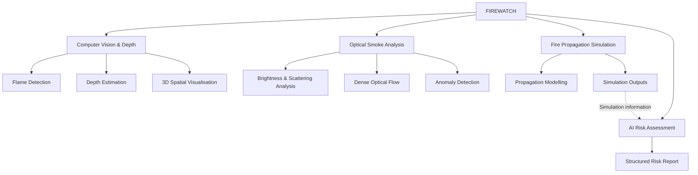

# NASA-SPACE-APPS-CHALLENGE_FIREWATCH_
### An Intelligent Multi-Modal Fire Detection, Spatial Analysis & Risk Assessment Framework

<p align="center">
  
</p>

<p align="center">
  **SEE THE FIRE. MAP THE THREAT. PREDICT THE RISK.**
</p>

<p align="center">
  
  
  
  
</p>

---

## 01. Overview

**FIREWATCH** is an experimental intelligent fire-monitoring framework that explores how computer vision, optical sensing, spatial estimation, fire propagation modelling, and artificial intelligence can work together to improve fire detection and situational awareness.

Conventional fire monitoring often focuses on identifying the presence of a fire. FIREWATCH explores a broader question:

**What if a fire-monitoring system could not only identify a fire, but also estimate its spatial characteristics, analyse its surrounding optical environment, simulate its potential propagation, and communicate the resulting risks?**

The project is organised into four independently developed computational systems:

1. **Computer Vision & Spatial Localisation** — Detecting flames and estimating their spatial characteristics using computer vision and depth estimation.
2. **Optical Smoke Analysis** — Analysing smoke-induced changes in brightness, scattering patterns, and apparent optical motion.
3. **Fire Propagation Simulation** — Modelling the progression of a fire under configurable simulation conditions.
4. **AI-Driven Risk Assessment** — Translating simulation outputs and environmental information into structured risk assessments.

These modules are being developed as independent components with the intention of bringing them together under a unified FIREWATCH interface.

---

## 02. System Architecture

<p align="center">
  
</p>

FIREWATCH follows a modular architecture. Each component has its own processing pipeline, inputs, outputs, and dependencies.



**Development philosophy:** The modules are independently executable. Their presence in one repository does not imply that every component is already connected through a fully autonomous pipeline.

---

## 03. The Four Core Systems

### 3.1 Computer Vision & 3D Spatial Localisation

<p align="center">
  
  
</p>

The computer vision subsystem investigates the detection and spatial characterisation of flame regions from visual input.

Its processing pipeline includes:

- Image acquisition and preprocessing.
- Deep-learning-based flame detection.
- Identification of flame regions within image frames.
- Depth estimation for detected regions.
- Spatial localisation and 3D visualisation.
- Model training and evaluation analysis.

The intention is to move beyond a simple binary fire/no-fire classification and investigate the spatial properties of detected flames.

**Key outputs:**
- Flame detection results.
- Bounding boxes and confidence values.
- Estimated depth information.
- 3D spatial visualisation.
- Model evaluation and performance metrics.

**Important research consideration:** Depth estimated from a monocular image is not equivalent to directly measured physical distance. Its accuracy depends on the model, assumptions, training data, and scene characteristics.

**Module location:** `depth/`

---

### 3.2 Optical Smoke Analysis

<p align="center">
  
  
</p>

The optical smoke subsystem investigates whether changes in the optical appearance and movement of smoke can be used as indicators of smoke presence.

Rather than relying exclusively on conventional smoke classification, this experimental approach examines how smoke interacts with controlled illumination inside a chamber.

A camera observes the illuminated region while image-processing algorithms quantify changes in the captured frames.

#### Experimental setup

The current prototype uses:

- An enclosed observation chamber.
- A controlled airflow arrangement using a fan.
- A phone-based illumination source.
- A camera observing the illuminated chamber.
- A computer running real-time image analysis.

Smoke entering the chamber changes the observed light distribution through scattering, attenuation, and changes in visible texture.

#### Optical measurements

The system investigates several complementary measurements:

| Measurement | Purpose |
|---|---|
| Mean brightness | Tracks changes in overall image intensity. |
| Brightness standard deviation | Measures spatial variation in illumination. |
| Bright-region coverage | Quantifies the proportion of pixels exceeding a brightness threshold. |
| Foreground coverage | Measures changes identified by background subtraction. |
| Dense optical flow | Estimates apparent pixel motion between consecutive frames. |
| Flow magnitude | Quantifies the magnitude of apparent image motion. |
| Flow direction | Estimates the dominant direction of apparent image motion. |
| Temporal variation | Tracks changes in optical measurements over time. |

#### Baseline-relative anomaly detection

The system first establishes a clean-air reference measurement.

Subsequent observations are compared against this baseline to identify unusual optical changes.

For a measured parameter \(X\), a baseline-relative deviation can be represented as:

\[
Z_X = \frac{|X_t-X_0|}{\sigma_0+\epsilon}
\]

Where:

- \(X_t\) is the current measurement.
- \(X_0\) is the clean-air baseline.
- \(\sigma_0\) is the baseline variability.
- \(\epsilon\) prevents division by zero.

Brightness and optical-flow deviations are combined with additional image measurements to generate an experimental anomaly score.

A persistence mechanism helps prevent isolated frame changes from immediately triggering an alert.

#### Detection states

- **NORMAL** — No significant deviation from the captured baseline.
- **POSSIBLE SMOKE INDICATOR** — An unusual optical change has been observed.
- **SMOKE INDICATOR DETECTED** — The configured anomaly conditions have persisted sufficiently to activate the alert.
- **CALIBRATION REQUIRED** — A clean-air baseline has not yet been captured.

The alert represents an optical anomaly consistent with the expected experimental observations. It is not a certified smoke alarm or a chemically validated smoke detector.

**Module location:** `smoke_detection/`

---

### 3.3 Fire Propagation Simulation

<p align="center">
  
</p>

The fire propagation subsystem explores how fire may evolve across a simulated environment.

Rather than treating a detected fire as an isolated visual event, this module investigates its potential progression under defined simulation conditions.

The simulator is independently developed and maintained as a separate component.

Its capabilities and physical assumptions depend on the specific simulation implementation.

The intended areas of analysis include:

- Configurable simulation conditions.
- Fire progression over time.
- Spatial representation of affected regions.
- Visualisation of propagation.
- Numerical simulation outputs.
- Exportable information for subsequent risk analysis.

**Module location:** `fire_simulation/`

---

### 3.4 AI-Driven Risk Assessment

<p align="center">
  
</p>

The risk-assessment subsystem explores the use of large language models to interpret fire-related simulation information and produce structured assessments.

The objective is to translate technical simulation outputs into information that is easier to interpret and act upon.

The system is designed to receive structured inputs, including relevant simulation results and contextual information.

Its intended outputs include:

- Identified hazards.
- Potential consequences.
- Risk severity classifications.
- Contextual explanations.
- Suggested mitigation measures.
- Structured assessment reports.

The language model acts as an analytical reporting layer. Its outputs are dependent on the quality of its inputs and should not be interpreted as independently validated engineering or emergency-response advice.

API credentials, where required, should be supplied through environment variables rather than committed to the repository.

**Module location:** `risk_assessment/`

---

## 04. Why This Approach?

FIREWATCH explores a combination of complementary sensing and analytical techniques.

| Conventional approach | FIREWATCH research direction |
|---|---|
| Identify visible fire | Detect and spatially characterise flame regions |
| Rely on a single visual indicator | Investigate multiple optical measurements |
| Observe a fire at one point in time | Explore fire propagation through simulation |
| Present raw numerical outputs | Generate structured AI-assisted risk reports |

The central idea is that fire monitoring can benefit from combining detection, measurement, modelling, and interpretation rather than treating them as isolated tasks.

---

## 05. Research Context: Microgravity Fire Behaviour

An important motivation for FIREWATCH is the broader problem of fire behaviour in environments where gravity-driven convection is reduced, including spacecraft and microgravity research environments.

Flames in microgravity can behave differently from flames in ordinary terrestrial environments.

On Earth, buoyancy-driven convection influences flame shape, hot-gas movement, oxygen transport, and the movement of combustion products.

In microgravity, buoyancy-driven effects are significantly reduced, changing the transport processes that influence flame behaviour.

This creates important challenges for fire detection and monitoring:

- Flame geometry may differ from familiar terrestrial flames.
- Smoke and combustion products may disperse differently.
- Natural buoyant transport is altered.
- Conventional visual assumptions may not transfer directly.
- Detection and monitoring methods require appropriate validation under relevant environmental conditions.

FIREWATCH investigates technologies that could contribute to more comprehensive fire monitoring.

**Research limitation:** Terrestrial fire and smoke datasets do not establish performance in microgravity. The current prototype is an exploratory engineering effort, not a microgravity-validated fire safety system. Dedicated datasets and controlled validation experiments would be necessary to establish suitability for spaceflight environments.

---

## 06. Repository Structure

The repository is organised into independently maintained modules.

```text
FIREWATCH/
│
├── README.md
│
├── assets/
│   ├── firewatch_banner.png
│   ├── firewatch_architecture.png
│   ├── firewatch_dashboard.png
│   ├── fire_detection.png
│   ├── depth_localization.png
│   ├── smoke_chamber.jpg
│   ├── optical_flow.png
│   ├── fire_simulation.png
│   └── risk_assessment.png
│
├── depth/
│   ├── [Computer vision and depth estimation files]
│   └── [Model weights and configuration]
│
├── smoke_detection/
│   ├── firewatch_smoke.py
│   └── [Optional sample data]
│
├── fire_simulation/
│   └── [Fire propagation simulation files]
│
└── risk_assessment/
    └── [AI risk assessment files]
```

Individual module folders may contain their own dependency files, configuration, documentation, and execution instructions.

---

## 07. Installation & Execution

FIREWATCH is currently organised as a modular collection of Python systems.

Each module should be installed and executed according to its own dependencies.

### General requirements

- Python 3.10 or later, subject to individual module compatibility.
- Git.
- A compatible camera for live optical smoke analysis.
- Additional model weights and dependencies for the relevant modules.

### Clone the repository

```bash
git clone https://github.com/mukund-mv/FIREWATCH.git

cd FIREWATCH
```

### Smoke detection module

```bash
cd smoke_detection

python -m venv .venv
```

Linux:

```bash
source .venv/bin/activate
```

Windows:

```bash
.venv\Scripts\activate
```

Install the dependencies:

```bash
python -m pip install --upgrade pip

python -m pip install opencv-python-headless numpy matplotlib pillow
```

Run:

```bash
python firewatch_smoke.py
```

The smoke-monitoring application uses OpenCV for image processing and a separate graphical interface for visualisation.

**Note:** Use `opencv-python-headless` rather than installing multiple OpenCV distributions in the same Python environment. This avoids common conflicts involving OpenCV's bundled Qt libraries.

For the other modules, consult their respective folder-level documentation as their dependencies and execution commands may differ.

---

## 08. Experimental Setup

<p align="center">
  
</p>

The physical smoke-monitoring experiment provides a controlled environment for testing the optical analysis subsystem.

The chamber allows smoke to enter through a controlled airflow path while the camera observes changes in the illuminated region.

The setup is intended to investigate the relationship between smoke presence and measurable image characteristics.

Experimental variables include:

- Illumination intensity and position.
- Camera position and exposure.
- Smoke movement through the chamber.
- Image brightness and spatial distribution.
- Apparent optical motion.
- Background and environmental disturbances.

Repeatable experiments and controlled baselines are important for evaluating whether observed changes are associated with smoke rather than changes in lighting, camera movement, or other disturbances.

---

## 09. Evaluation & Validation

FIREWATCH is an experimental prototype, and its individual modules require separate evaluation.

Relevant evaluation areas include:

| Subsystem | Evaluation criteria |
|---|---|
| Flame detection | Precision, recall, mAP, confidence behaviour |
| Depth estimation | Depth error and spatial consistency |
| Smoke analysis | Baseline stability, detection latency, false-positive rate |
| Optical flow | Motion consistency and sensitivity to disturbances |
| Fire simulation | Numerical stability and comparison with reference scenarios |
| Risk assessment | Output consistency, completeness, and expert review |

Metrics should be reported with their corresponding datasets, test conditions, and evaluation methods.

Training, validation, test, and experimental results should be clearly distinguished.

No unverified performance figures are presented as established results.

---

## 10. Current Limitations & Future Work

FIREWATCH is a work in progress. Its current research limitations include:

1. **Microgravity validation:** The current systems have not been validated in a microgravity environment.
2. **Depth uncertainty:** Monocular depth estimation is subject to model and scene-dependent error.
3. **Smoke specificity:** Optical anomalies are not equivalent to chemical identification or calibrated smoke concentration.
4. **Lighting sensitivity:** Changes in illumination, reflections, and camera exposure can influence optical measurements.
5. **Simulation assumptions:** Propagation predictions depend on the assumptions and parameters of the simulator.
6. **AI reliability:** Generated risk reports require verification and should not replace qualified safety assessments.
7. **System integration:** The modules are independently developed; a fully automated end-to-end pipeline remains a development objective.

### Planned development

- Improve repeatability and calibration of optical smoke measurements.
- Expand smoke detection experiments across different illumination and airflow conditions.
- Improve depth estimation and spatial validation.
- Investigate appropriate microgravity fire datasets and reference experiments.
- Validate simulation outputs against reference scenarios.
- Improve the exchange of structured data between modules.
- Develop a unified application interface.

---

## 11. Technology Stack

The project uses technologies from several areas of engineering and computer science.

| Area | Technologies |
|---|---|
| Programming | Python |
| Computer vision | OpenCV |
| Numerical computing | NumPy |
| Deep learning | Model-dependent frameworks |
| Optical motion analysis | Farneback dense optical flow |
| Visualisation | Matplotlib and 3D visualisation tools |
| Simulation | Python-based modelling |
| AI reporting | Large language models |
| Version control | Git and GitHub |

Specific framework versions and additional dependencies are documented within the respective modules.

---

## 12. Contributing & Development

FIREWATCH is organised to support independent development of its subsystems.

When modifying the repository:

- Keep each subsystem's implementation within its own folder.
- Preserve the relevant model weights and configuration files.
- Document installation requirements.
- Include example inputs and outputs where practical.
- Clearly identify experimental and validated results.
- Avoid committing virtual environments, generated caches, API keys, or unnecessary large datasets.

For major changes, include a description of the affected module and its dependencies.

---

## 13. Acknowledgements

Developed as an experimental engineering project for the **NASA Space Apps Challenge**.

FIREWATCH brings together research and implementation across computer vision, optical sensing, spatial analysis, simulation, and artificial intelligence.

The project is motivated by the broader challenge of improving fire monitoring and situational awareness in environments where conventional assumptions about fire behaviour may not hold.

---

## 14. Project Information

**Project:** FIREWATCH  
**Domain:** Intelligent Fire Monitoring & Risk Analysis  
**Application:** NASA Space Apps Challenge  
**Implementation:** Python-based modular research prototype  
**Repository:** [GitHub Repository](https://github.com/mukund-mv/FIREWATCH)

<p align="center">
  
</p>

<p align="center">
  **DETECT · LOCALISE · SIMULATE · ASSESS**
</p>

<p align="center">
  *Engineering a more comprehensive approach to fire intelligence.*
</p>
